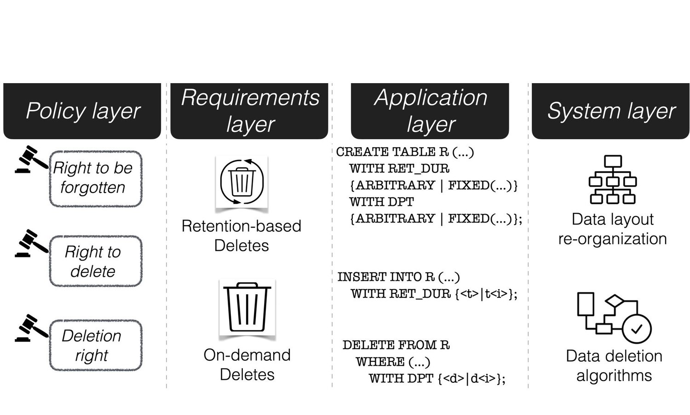

> # Persistent Deletes

### Achieving Persistent Deletes

Most modern data systems have been designed with two goals in mind -- fast ingestion and low-latency query processing. The first goal has led to the development of a plethora of write-optimized data stores that employ the out-of-place paradigm. Due to their write-optimized design, out-of-place data systems perform deletes logically via invalidation, and retain the invalid data for arbitrarily long. However, due to the recent enactment of new data privacy regulations, the requirement of timely deletion of user data has become central. Logical deletion in out-of-place data systems, however, does not offer guarantees for timely and persistent deletion, and attempting to enforce it using existing tools leads to poor performance and increased operational costs.

The goal of this project is to design a new framework for building deletion-compliant data systems from a holistic perspective. We analyze the new regulations and the requirements derived from the new policies, and we propose changes in the application and the system layer of data management.

- **Policy and User Requirements Layer**  
  In recent years, a number of government-driven efforts across the globe unfolded, aiming
  to protect the privacy of user data and give back to the users the control of their personal data. On the legal
  side, regulations such as the EU’s GDPR, California’s CCPA and CPRA, and Virginia’s VCDPA
  have been introduced, which mandate that data companies ensure privacy through deletion. GDPR’s
  right to be forgotten, CCPA and CPRA’s right to delete, and the deletion right in VCDPA particularly focus on
  persistent deletion of user data on-demand and in a timely manner.  
  As a first step of the project, we identified the two classes of data deletion requests outlined by the regulations: (a) *retention-driven deletes* and (b) *on-demand deletes*. For the first class of deletes, the user sets a retention duration as part of the SLA, and any data older than the retention duration must be persistently deleted from the databases of the service providers. The second class of deletes supports on-demand data deletion, subject to ad-hoc user requests, wherer the users may submit their deletion requests through an API and the service providers must persistently delete the user data within a threshold duration specified by the deletion regulation.
- **Application Layer**  
  Next, we augment the query language at the application layer to support the two classes of deletion requirements. State-of-the-art query
  languages do not have support for timely data deletion; in fact, they lack the APIs necessary to express the user/application requirements for timely deletion. To support retention-driven deletion, we augment both the CREATE TABLE and INSERT INTO statements so that a relational table can be associated with a number of options for specific retention durations. Every data object is bound to a specific retention duration according to the application SLA or the user preference. To ensure timely persistence of on-demand deletion requests, we augment the CREATE TABLE and
  DELETE FROM statements to allow a relational table to support a predetermined set of timely deletion guarantees, and each deletion to select the level of service to which it adheres. Finally, we extend the query language to support
  arbitrary retention duration as well as arbitrary deletion persistence thresholds for oon-demand deletion.
- **System Layer**  
  With the requirement analysis and the declarative interface in place, the users and the applications can express
  all the mandated deletion requests and the underlying system is now tasked with implementing them. Timely data deletion while respecting the retention SLAs without hurting the system performance is a key challenge. The efficiency of deletion depends on the schema and the physical data layout, the data re-organization
  strategy, the workload, and the design of the storage engine.
  Toward this, as a part of this project, we built a new key-value storage engine, Lethe, introduces a set of new delete-aware compaction policies and a new physical data layout that together can support timely and persistent deletion of data at the storage engine level. For a given workload and under a given latency requirement for delete persistence, Lethe offers maximal performance, by carefully tuning the cost of persistent deletes, and their impact on the overall performance of the system.

### Relevant Publications

- Subhadeep Sarkar, Tarikul Islam Papon, Dimitris Staratzis, Manos Athanassoulis, "[**Lethe: A Tunable Delete-Aware LSM Engine**](http://disc-projects.bu.edu/lethe/)", In Proceedings of the ACM SIGMOD International Conference on Management of Data, 2020 [[PDF]](https://dl.acm.org/doi/abs/10.1145/3318464.3389757)
- Subhadeep Sarkar, Manos Athanassoulis, "**Query Language Support for Timely Data Deletion**", In Proceedings of the International Conference on Extending Database Technology (EDBT), 2022 [[PDF]](http://openproceedings.org/2022/conf/edbt/paper-131.pdf)
- Manos Athanassoulis, Subhadeep Sarkar, Tarikul Islam Papon, Zichen Zhu, Dimitris Staratzis, "**Building Deletion-Compliant Data Systems**", IEEE Data Engineering Bulletin (DEBull), 2022 [[PDF]](https://cs-people.bu.edu/papon/pdfs/debull22-athanassoulis-preprint.pdf)
