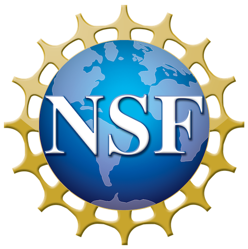

Prof. Athanassoulis awarded the NSF CRII grant on Optimal Data Organization for HTAP Data Systems. The grant is sponsored by the NSF Information Integration and Informatics (III) Program within the Division of Information and Intelligent Systems (IIS).

