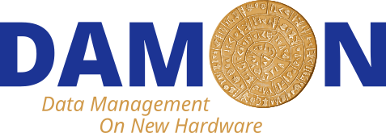

Two papers to be presented in [DAMON 2021](https://sites.google.com/view/damon2021), the premier workshop for data management research on new hardware, co-located with [ACM SIGMOD 2021](https://2021.sigmod.org/):

- [Reducing Bloom Filter CPU Overhead in LSM-Trees on Modern Storage Devices](http://cs-people.bu.edu/mathan/publications/damon21-zhu.pdf)
- [A Parametric I/O Model for Modern Storage Devices](http://cs-people.bu.edu/mathan/publications/damon21-papon.pdf)

