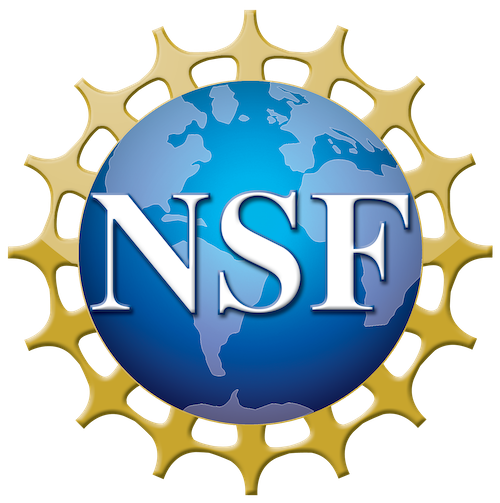

The research and education program of DiSC lab will be [funded for the next five years through an NSF CAREER award on Robust LSM-based Data Stores](https://www.nsf.gov/awardsearch/showAward?AWD_ID=2144547&HistoricalAwards=false). The grant is sponsored by the NSF Information Integration and Informatics (III) Program within the Division of Information and Intelligent Systems (IIS).

