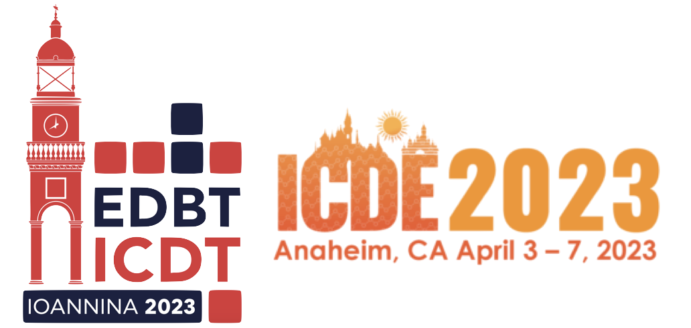

We will be presenting five papers on various topics in the next few months at EDBT and ICDE:

- [Relational Memory: Native In-Memory Accesses on Rows and Columns](/papers/edbt23-relational-memory), EDBT 2023
- [Indexing for Near-Sorted Data](/papers/icde23-raman), ICDE 2023
- [ACEing the Bufferpool Management Paradigm for Modern Storage Devices](/papers/icde23-papon), ICDE 2023
- [The LSM Design Space and its Read Optimizations](/papers/icde23-sarkar) (tutorial), ICDE 2023
- [Relational Fabric: Transparent Data Transformation](/papers/icde23-vision-papon) (vision), ICDE 2023

