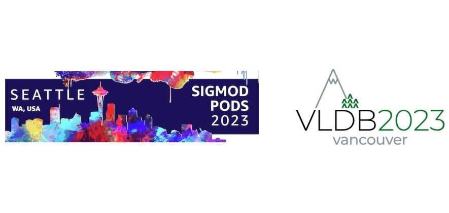

We will be presenting two demos and a PhD workshop paper over Summer 2023:

- [Acheron: Persisting Tombstones in LSM Engines](/papers/sigmod23-acheron), SIGMOD 2023
- [On-the-fly Data Transformation in Action](/papers/vldb23-mun), VLDB 2023
- [SHaMBa: Reducing Bloom Filter Overhead in LSM Trees](/papers/vldb23-phdworkshop-shamba), VLDB PhD Workshop 2023

