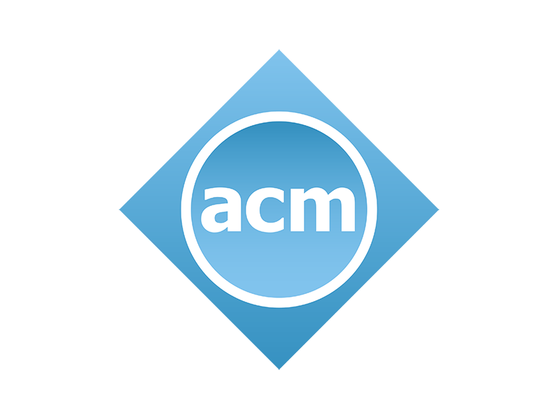

Our paper "[Enabling Timely and Persistent Deletion in LSM-Engines](/papers/tods2023-sarkar)" has been accepted for publication at ACM TODS.

Our paper "[NOCAP: Near-Optimal Correlation-Aware Partitioning Joins](/papers/pacmod23-zhu)" has been accepted for publication at the Proceedings of ACM Management of Data (PACMMOD) and presentation at SIGMOD 2024!

