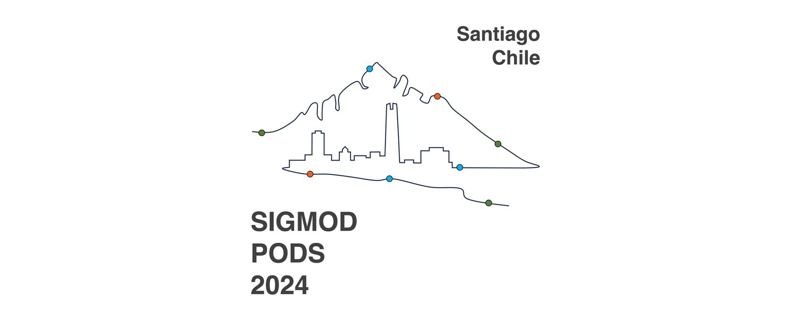

DiSC participated in the ACM SIGMOD 2024 conference with two research papers, two workshop papers in DBTest, and one invited talk in the 20th instance of DAMON.

- ["CAVE: Concurrency-Aware Graph Processing on SSDs"](/papers/sigmod24-cave)
- ["NOCAP: Near-Optimal Correlation-Aware Partitioning Joins"](/papers/pacmod23-zhu)
- ["Benchmarking Learned and LSM Indexes on Data Sortedness"](/papers/dbtest24-bliss)
- ["KVBench: A Key-Value Benchmarking Suite"](/papers/kvbench-dbtest24-zczhu)
- ["Effortless Locality Through On-the-fly Data Transformation"](https://damon-db.org/#sec-ind-3)

Read more about all our papers and presentations in this blog post: <https://blogs.bu.edu/mathan/2024/06/18/disc-at-sigmod-2024/>

Further, Prof. Athanassoulis received the ACM SIGMOD Distinguished PC Member award.

