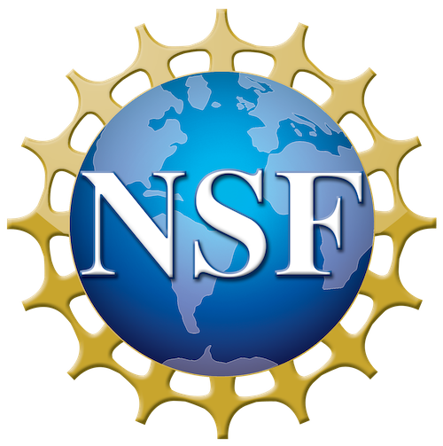

DiSC lab's research on near-memory data transformation wil be funded for the next four years through an NSF medium award on "[Effortless Data Locality Through Near-memory On-the-fly Data Transformation](https://www.nsf.gov/awardsearch/showAward?AWD_ID=2403012&HistoricalAwards=false)". This is joint work with [Prof. Mancuso](https://cs-people.bu.edu/rmancuso/) from Boston University and [Prof. Yun](https://www.ittc.ku.edu/~heechul/) from the University of Kansas.

