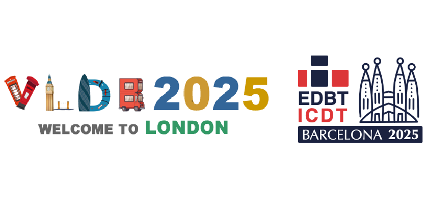

Excited to share that we got three papers recently accepted at VLDB and EDBT that focus on delivering better indexing! Pre-prints are available below:

- Our journey to developing sortedness-aware indexing continues with a simple yet very powerful design called Quick Insertion Tree (QuIT), which allows near-bulk-load index ingestion when data comes near-sorted without any performance hit on read queries! "[QuIT your B+-tree for the Quick Insertion Tree](https://cs-people.bu.edu/mathan/publications/edbt25-raman.pdf)" will appear in EDBT 2025, Barcelona.
- We also have exciting results to share about our goal to transform bitmap indexes to general-purpose indexes capable of handling (almost) any workload (including update-heavy with high concurrency). We developed an approach for Concurrent Updatable Bitmap Indexing (or CUBIT) that uses lock-free fine-granular out-of-place updates to offer superb performance and scalability. "[CUBIT: Concurrent Updatable Bitmap Indexing](https://cs-people.bu.edu/mathan/publications/vldb24-wang.pdf)" will appear at VLDB 2025, London.
- Finally, our experimental analysis on Write Amplification in RocksDB helped us uncover a variation of the round-robin file-picking policy for compaction that is very close to the best possible design, both in terms of performance stability and write amplification. "[Benchmarking, Analyzing, and Optimizing Write Amplification of Partial Compaction in RocksDB](https://cs-people.bu.edu/mathan/publications/edbt25-wei.pdf)" will appear at EDBT 2025, Barcelona.

