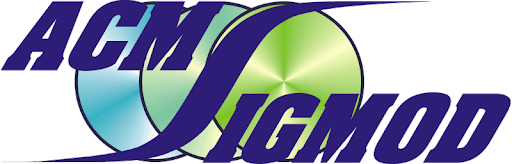

Prof. Athanassoulis got elected as SIGMOD Secretary/Treasurer for a four year term. He will serve as a [SIGMOD Officer](https://sigmod.org/about-sigmod/) alongside [Prof. Angela Bonifati](https://perso.liris.cnrs.fr/angela.bonifati/) (SIGMOD Chair) and [Prof. Alexandra Meliou](https://people.cs.umass.edu/~ameli/) (SIGMOD Vice-Chair).

