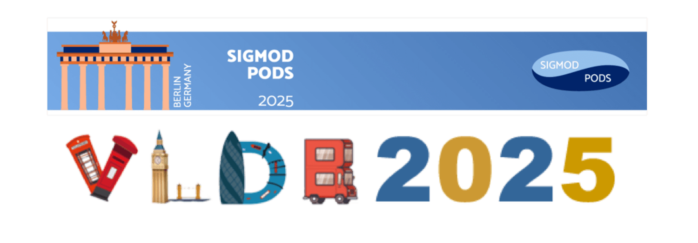

DiSC's summer conferences presence includes

- ["Mnemosyne: Dynamic Workload-Aware BF Tuning via Accurate Statistics in LSM trees"](/papers/pacmmod25-zhu), Research Paper at SIGMOD 2025
- ["ACE-in-Action: A Smart DBMS Bufferpool for SSDs"](/papers/sigmod25-ace-in-action), Demo at SIGMOD 2025
- ["CUBIT: Concurrent Updatable Bitmap Indexing"](/papers/vldb24-wang), Research Paper at VLDB 2025
- ["Micro-architectural Exploration of the Relational Memory Engine (RME) in RISC-V and FireSim"](/papers/adms25-strickler), Workshop Paper at ADMS@VLDB 2025
- ["Exploring Wavelet Trees as Space-Efficient Physical-to-Sorted Mapping for Learned Indexes"](/papers/aidb25-saha), Workshop Paper at AIDB@VLDB 2025

Further, during SIGMOD 2025 it was announced that Prof. Athanassoulis was elected Secretary/Treasurer for SIGMOD for 2025 through 2029 and received the ACM SIGMOD Distinguished PC Member award.

