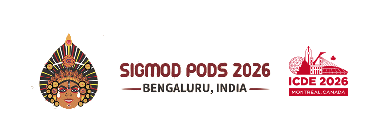

DiSC will have two papers in the main research track of SIGMOD 2026, one paper in the main research track of ICDE 2026 and one invited keynote in HTAPSys collocated with ICDE 2026:

- [ReStore: A Reinforcement Learning Approach for Data Migration in Multi-Tiered Storage](/papers/pacmmod25-zhang), Tianru Zhang, Tarikul Islam Papon, Teona Bagashvili, Salman Toor, Manos Athanassoulis, PACMMOD, Vol 4(3), 2026
- [RABIT: Efficient Range Queries with Bitmap Indexing](/papers/pacmmod25-wang), Junchang Wang, Fu Xiao, Manos Athanassoulis, PACMMOD, Vol 3(6), 2025
- [RangeReduce: Query-Driven LSM Compactions](/papers/icde26-kaushik), Shubham Kaushik, Manos Athanassoulis, Subhadeep Sarkar, ICDE 2026
- Building Bitmap Indexes for Hybrid Workloads: A tale of UPBIT, CUBIT, and RABIT, [Keynote @ HTAPSys 2026](https://sfu-dis.github.io/htapsys/)

