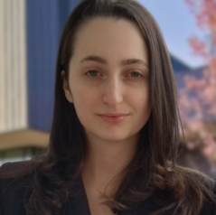

Two DiSC PhD students are starting research internships this month: [Anwesha](https://cs-people.bu.edu/anwesha/) joins Google from May to August 2026, and [Teona](https://cs-people.bu.edu/teona/) joins Samsung from May to November 2026. Good luck to both!

{: style="width: 100%"}

{: style="width: 100%"}

