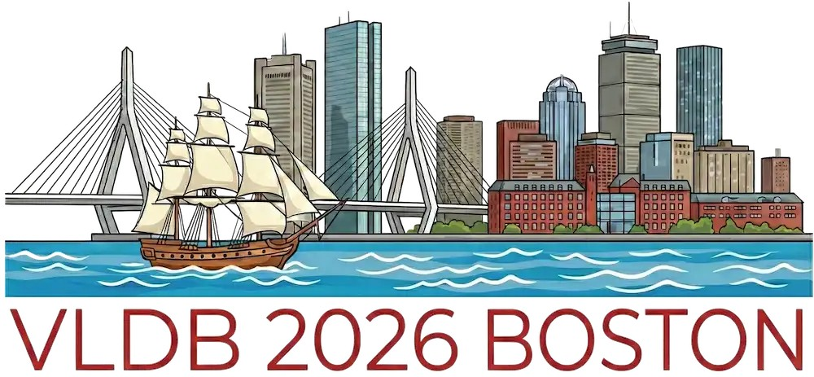
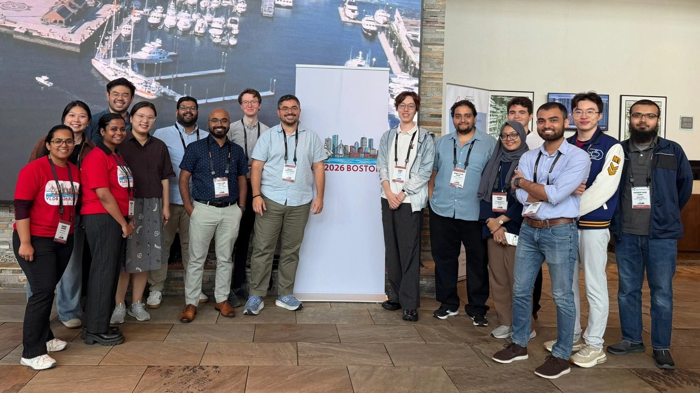

{: style="width: 60%; margin: 0 auto 24px"}

VLDB 2026 took place in Boston (August 31 – September 4, 2026), and DiSC was there with a keynote, a research paper, and two demos:

- Keynote at ADMS@VLDB 2026: "Building General-Purpose Bitmap Indexes: A tale of [CUBIT](/papers/vldb24-wang), [RABIT](/papers/pacmmod25-wang), and beyond" by Prof. Athanassoulis (Monday, August 31)
- ["AXE: A Task Decomposition Approach to Learned LSM Tuning"](/papers/vldb25-huynh), Research Paper at VLDB 2026 (Research 32: Learned Database Tuning, Wednesday, September 2)
- ["Demonstrating Indexing for Near-Sorted Data"](/papers/vldb26-raman), Demo at VLDB 2026 (Demo Group B, Tuesday, September 1 and Thursday, September 3)
- ["ReStore-in-Action: Adaptive Multi-Tier Storage Management via Intelligent Data Migration Policy"](/papers/vldb26-eusuf), Demo at VLDB 2026 (Demo Group B, Tuesday, September 1 and Thursday, September 3)

Prof. Athanassoulis also served as a Local Arrangements Chair for the conference, together with DiSC alumnus [Tarikul Islam Papon](https://www.linkedin.com/in/tarikul-islam-papon-264581191/) (UMass Boston).

